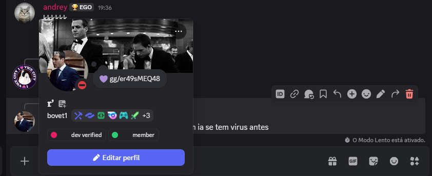
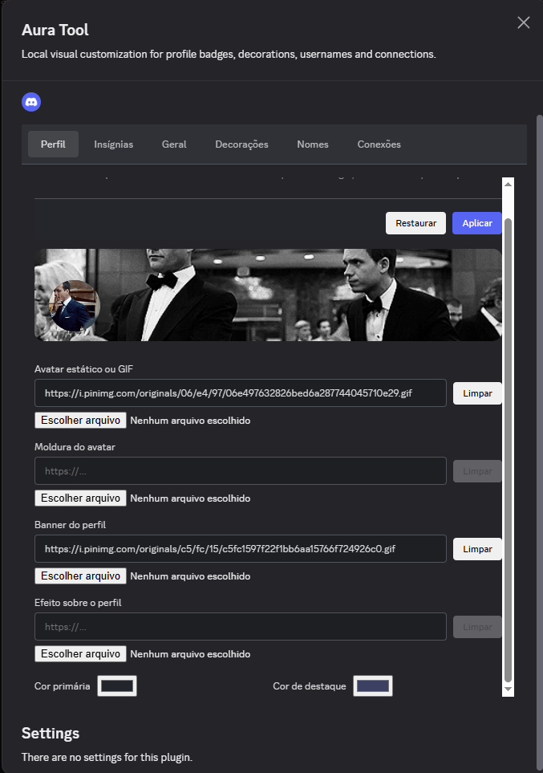
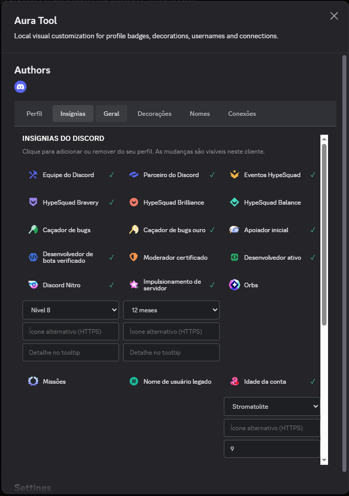

# Aura Tool

[Português (Brasil)](#português-brasil) · [English](#english) · [Releases](../../releases) · [Discord](https://discord.gg/er49sMEQ48)

## Prévias / Screenshots

| Perfil / Profile | Aparência / Appearance | Insígnias / Badges |
| --- | --- | --- |
|  |  |  |

Clique em uma captura para ampliar. / Click a screenshot to enlarge it.

## Português (Brasil)

O Aura Tool é um plugin para o Vencord que personaliza a aparência do seu perfil no Discord para quem está usando esse cliente. As alterações são locais. Outros membros continuam vendo o perfil real da sua conta. Insígnias, conexões e cosméticos adicionados pelo plugin são elementos visuais e não mudam assinaturas, conquistas nem contas vinculadas no Discord.

### O que dá para personalizar

| Aba | Recursos |
| --- | --- |
| **Perfil** | Troque o avatar por uma imagem ou GIF, adicione moldura, banner e efeito sobre o perfil, e escolha duas cores para o tema. Confira a prévia e clique em **Aplicar**. Para remover os ajustes da aba, use **Restaurar**. |
| **Insígnias** | Adicione ícones do catálogo do Discord à fileira de insígnias. Idade da conta, Nitro, impulsionamento e outras categorias têm variantes e detalhes editáveis. Também é possível criar insígnias visuais próprias. |
| **Decorações** | Adicione texto, ícones e efeitos visuais a partes do perfil. |
| **Nomes** | Configure nomes exibidos localmente, com cor, gradiente, sombra e animação. |
| **Conexões** | Crie cartões visuais com nome, ícone, URL, cor e ordem. Há modelos para GitHub, Steam, YouTube, Twitch, Spotify e Reddit, além do modelo personalizado. |
| **Geral** | Ative ou desative as personalizações e consulte a biblioteca de ícones. |

O efeito do perfil usa uma imagem ou um GIF sobreposto. Os campos de mídia aceitam URLs HTTPS e arquivos locais GIF, PNG, JPEG, WebP ou AVIF de até 2 MiB por arquivo.

### Requisitos e instalação no Windows

1. Tenha um [checkout do código-fonte do Vencord](https://github.com/Vendicated/Vencord) e instale Git, Node.js e a versão de pnpm indicada no `package.json` desse checkout.
2. Baixe [AuraTool-source.zip](../../releases/download/v1.0.0/AuraTool-source.zip) em **Releases** e extraia a pasta inteira antes de executar o instalador.
3. Execute `install.bat`. Ele procura o checkout em pastas comuns, copia o plugin para `src/userplugins/AuraTool` e compila o Vencord.
4. Recarregue o Discord com **Ctrl+R**. Em **Configurações → Vencord Settings → Plugins**, ative **Aura Tool** e abra o ícone de informações no cartão para acessar o painel.

### Comandos do instalador

| Comando | O que faz |
| --- | --- |
| `install.bat` | Detecta o checkout, instala a fonte e compila. Também serve para atualizar o plugin usando um pacote novo. |
| `install.bat -VencordPath "D:\Projects\Vencord"` | Seleciona explicitamente a raiz do checkout. Use se a busca encontrar mais de uma cópia ou nenhuma. |
| `install.bat -WhatIf` | Mostra os caminhos detectados sem alterar arquivos. |
| `install.bat -Inject` | Compila e abre o fluxo oficial do Vencord para conectar o checkout ao Discord. |

### Solução de problemas

- **O plugin não aparece.** Confirme que o instalador terminou com sucesso e que o Discord está usando o mesmo checkout. Recarregue o cliente e procure por **Aura Tool** na lista de plugins.
- **A imagem aparece só na prévia.** Clique em **Aplicar**, reabra o perfil e tente usar o arquivo local se a URL externa falhar.
- **O build falha.** Confira a versão de Node.js e pnpm exigida pelo checkout do Vencord. O instalador restaura a fonte do Aura Tool anterior quando a atualização falha durante o build.

Para editar, altere os arquivos em [src](src) e rode o instalador novamente. Os ícones de várias insígnias vêm do [arquivo público de ícones do Discord](https://github.com/mezotv/discord-badges).

**Comunidade e suporte:** [entre no servidor do Discord](https://discord.gg/er49sMEQ48) para tirar dúvidas, relatar problemas ou sugerir melhorias.

## English

Aura Tool is a Vencord plugin for customizing how your Discord profile looks in your own client. Changes are local. Other members still see your actual Discord profile. Added badges, connections, and cosmetics are visual elements and do not change subscriptions, achievements, or linked accounts on Discord.

### What you can customize

| Tab | Features |
| --- | --- |
| **Profile** | Use an image or GIF as your avatar, add an avatar frame, banner, or profile overlay, and choose two theme colors. Check the preview and click **Apply**. Use **Restore** to reset this tab. |
| **Badges** | Add Discord badge icons to the profile badge row. Account age, Nitro, server boosting, and other categories offer variants and editable details. You can also make your own visual badges. |
| **Decorations** | Add text, icons, and visual effects to parts of your profile. |
| **Names** | Set local display names with colors, gradients, shadows, and animations. |
| **Connections** | Create visual cards with a name, icon, URL, color, and display order. Templates include GitHub, Steam, YouTube, Twitch, Spotify, Reddit, and a custom option. |
| **General** | Toggle customizations and browse the icon library. |

The profile effect displays an image or GIF overlay. Media fields accept HTTPS URLs and local GIF, PNG, JPEG, WebP, or AVIF files up to 2 MiB each. The current interface uses some Portuguese labels, including **Aplicar** for Apply and **Restaurar** for Restore.

### Windows requirements and installation

1. Set up a [Vencord source checkout](https://github.com/Vendicated/Vencord) with Git, Node.js, and the pnpm version specified in its `package.json`.
2. Download [AuraTool-source.zip](../../releases/download/v1.0.0/AuraTool-source.zip) from **Releases** and extract the entire folder before running the installer.
3. Run `install.bat`. It checks common locations, copies the plugin to `src/userplugins/AuraTool`, and builds Vencord.
4. Reload Discord with **Ctrl+R**. Go to **Settings → Vencord Settings → Plugins**, enable **Aura Tool**, and use the information icon on its card to open the panel.

### Installer commands

| Command | What it does |
| --- | --- |
| `install.bat` | Detects the checkout, installs the source, and builds Vencord. Run it again from a newer package to update the plugin. |
| `install.bat -VencordPath "D:\Projects\Vencord"` | Selects the checkout root explicitly if discovery finds multiple copies or none. |
| `install.bat -WhatIf` | Shows detected paths without changing files. |
| `install.bat -Inject` | Builds and runs Vencord’s official Discord installation flow. |

### Troubleshooting

- **The plugin is missing.** Check that the installer succeeded and Discord is using the same Vencord checkout. Reload and search the plugin list for **Aura Tool**.
- **An image only shows in the preview.** Click **Apply**, reopen your profile, and try a local file if the external URL fails.
- **The build fails.** Check the Node.js and pnpm versions required by your checkout. The installer restores the previous Aura Tool source when an update fails during the build.

To edit the plugin, change the files in [src](src) and run the installer again. Many badge icons come from the [public Discord badge icon archive](https://github.com/mezotv/discord-badges).

**Community and support:** [join the Discord server](https://discord.gg/er49sMEQ48) to ask questions, report issues, or suggest improvements.
